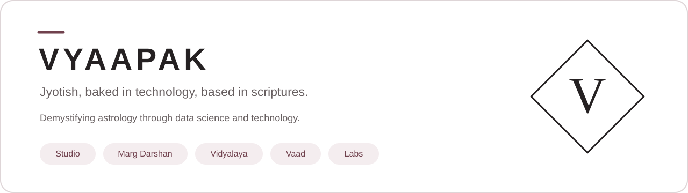

# VYAAPAK
### Jyotish, baked in technology, based in scriptures.

**A connected ecosystem for Jyotish practice, learning, and research.**

[Explore the ecosystem](PRODUCTS.md) · [Our principles](PRINCIPLES.md) · [Public updates](UPDATES.md)

---

## From studying knowledge to developing practice

Jyotish study, chart analysis, consultations, and research belong together. VYAAPAK brings these activities into a connected workspace, with an emphasis on structured knowledge, clear reasoning, and learning through application.

We are developing VYAAPAK for **practitioners, learners, and researchers** who want continuity between what they study, how they analyse, and what they learn from outcomes.

## The VYAAPAK ecosystem

| | Product | Purpose |
| :--- | :--- | :--- |
| **Practice** | **Studio** | Organise your practice, work with charts, and manage consultations. |
| **Learn** | **Marg Darshan** | Develop skills through guided practice and clear learning objectives. |
| **Study** | **Vidyalaya** | Explore concise knowledge connected to sources and learning objectives. |
| **Discuss** | **Vaad** | Participate in structured scenarios, predictions, and discussion. |
| **Investigate** | **Labs** | Connect research questions with evidence and evaluation. |

[Read the product overview →](PRODUCTS.md)

## What guides our work

**Knowledge with attribution.** Preserve the connection between a statement and its source.

**Reasoning people can follow.** Make the basis of an output understandable.

**Learning through application.** Connect study with practice, feedback, and progression.

**Evaluation with clear boundaries.** Distinguish calculation correctness, traditional interpretation, and predictive performance.

[Read our principles →](PRINCIPLES.md)

## Follow the development

This repository is VYAAPAK's public product showcase. Watch it for product updates and public announcements.

Product descriptions introduce the scope of the ecosystem. Access and availability will be announced explicitly; this showcase is not an access portal.

## Proprietary platform

VYAAPAK is a proprietary product. This repository contains public-facing product information only. Source code, internal architecture, ontology, rules, knowledge assets, models, and datasets are private.

No product source code or model weights are distributed through this repository.

---

**Practice with structure. Learn with direction. Research with accountability.**

